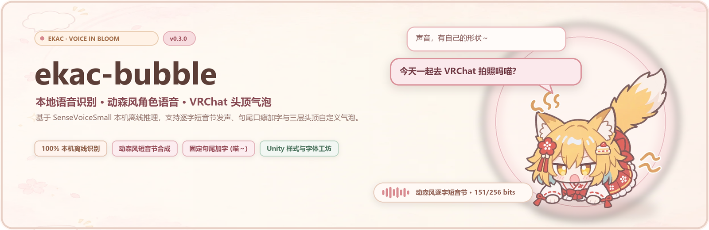
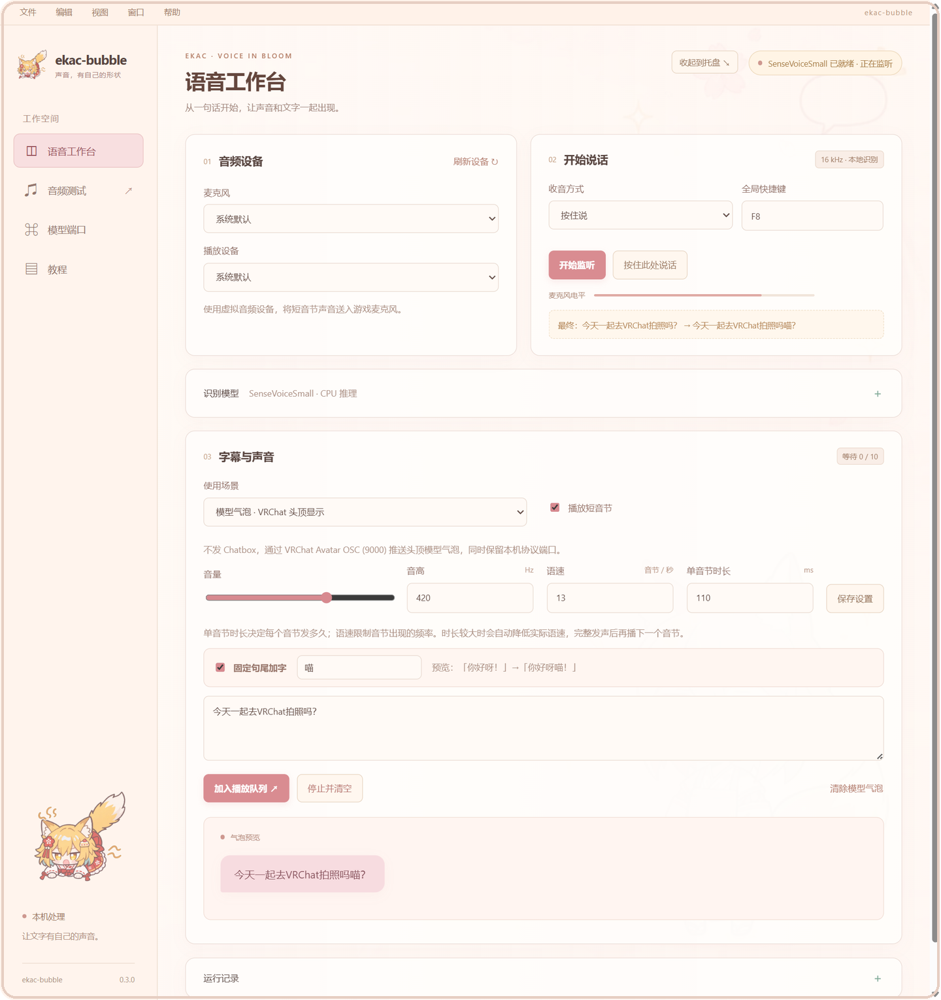
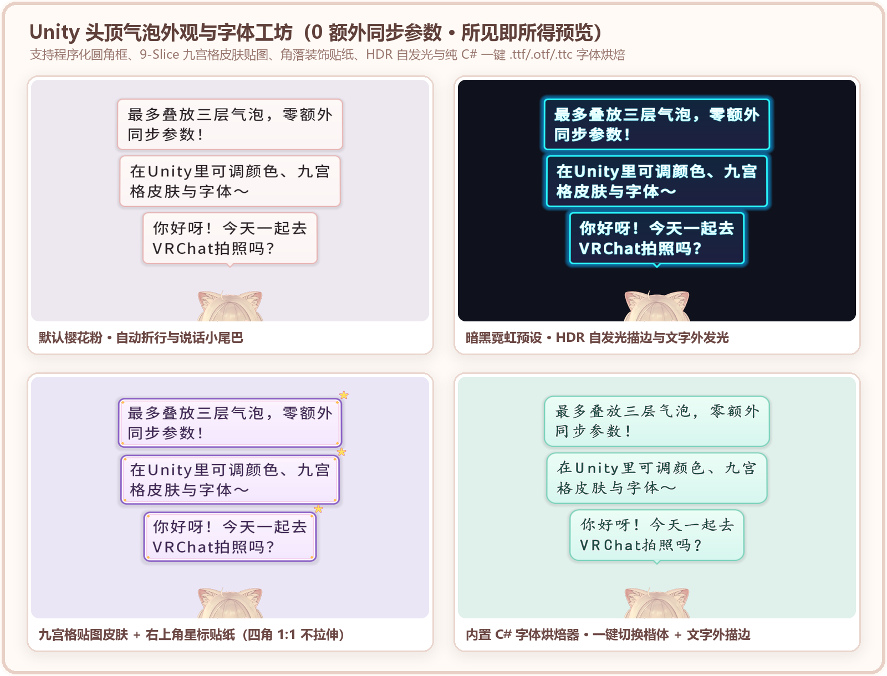
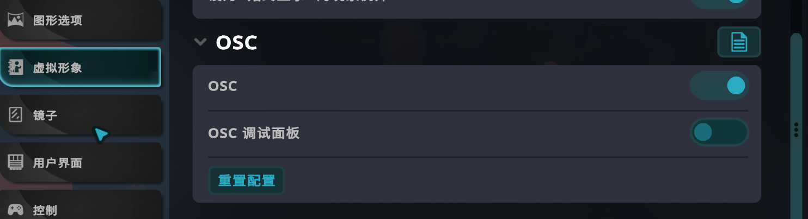

<div align="center">



<br />

[](https://github.com/dkdcakedangao/ekac-bubble/releases/latest)
[](#快速开始)
[](#核心亮点)
[](#unity-头顶气泡与字体工坊)
[](LICENSE)

<p>
  <strong>把你说出的每一句话，变成角色专属的短音节声音与头顶气泡。</strong>
</p>

<p>
  <a href="https://github.com/dkdcakedangao/ekac-bubble/releases/latest"><strong>📦 下载最新便携版</strong></a> ·
  <a href="#核心亮点">核心亮点</a> ·
  <a href="#三种使用场景">三种场景</a> ·
  <a href="#unity-头顶气泡与字体工坊">Unity 气泡工坊</a> ·
  <a href="#快速开始">快速开始</a> ·
  <a href="#常见问题">常见问题</a>
</p>

</div>

---

## 核心亮点

- **100% 本机离线识别**：内置 `SenseVoiceSmall`（INT8 CPU 推理），语音不上传云端；支持**按住快捷键说话（默认 `F8`）**与**持续监听**双模式，后台自动排队最多 10 句不漏话。
- **动森风逐字短音节合成**：参考《动物森友会》/ Coopanion 发声质感，根据中英日韩发音自动匹配音节、声调起伏与标点停顿，句尾问号自动升调、感叹号自动加重，支持独立调节**音高（200–800 Hz）**、**语速**与**单音节时长（60–400 ms）**。
- **固定句尾口癖加字**：支持一键开启句尾后缀（如自动加上 `喵`、`喵～`、`捏`），智能插入在句末标点之前并自动防叠字去重，短音节发声、Chatbox 与头顶气泡全链路同步生效。
- **VRChat 三层头顶气泡（零 Chatbox 占用）**：配套 Modular Avatar 一键无损挂载插件，仅占 `151 / 256` 同步 bits，支持双行自动折行、逐字弹入、最多三层气泡往上顶推与游戏内圆盘菜单实时开关/调高度/调缩放。
- **Unity 气泡外观与一键换字体工坊**：无需修改桌面端协议，在 Unity 内可视化定制圆角/直角框、**9-Slice 九宫格贴图皮肤**、猫耳/星标角标贴纸、HDR 自发光与文字外描边，并内置**纯 C# `.ttf / .otf / .ttc` SDF 字体烘焙器**。
- **纯绿色便携目录**：所有配置、日志与识别模型均保存在程序同级 `data/` 目录，不污染系统 `AppData`，整夹复制即可随身迁移。

---

## 工作台界面预览

<div align="center">
  
</div>

---

## 三种使用场景

| 模式 | 声音输出 | 字幕 / 气泡输出 | 适用场景 |
| :--- | :--- | :--- | :--- |
| **通用游戏 · 仅声音** | 输出至所选播放设备 / 虚拟声卡 | 仅软件内本地预览，不发外部端口 | 任意联机游戏语音、桌面直播角色配音 |
| **游戏 Chatbox · 整句发送** | 可选开关短音节声音 | VRChat 官方 Chatbox（`UDP 127.0.0.1:9000`，自动分段限频） | 未改模角色快速使用 VRChat 原生聊天框字幕 |
| **模型气泡 · VRChat 头顶显示** | 可选开关短音节声音 | Avatar OSC（`/avatar/parameters/EB_*`）驱动头顶三层自定义气泡 + `9011` 本地协议端口 | 已挂载 `ekac气泡插件` 的专属模型，高度定制外观与字体 |

---

## Unity 头顶气泡与字体工坊

<div align="center">
  
</div>

### 1. 一键无损挂载到 VRChat 模型
1. 确保 Unity 工程已安装 **VRChat Avatars SDK 3** 与 **Modular Avatar**。
2. 导入随包附带的 `ekac气泡插件.unitypackage`（位于便携包根目录或 [Release 下载页](https://github.com/dkdcakedangao/ekac-bubble/releases/latest)）。
3. 在 Hierarchy 选中你的模型根节点，点击顶部菜单 **`Tools → ekac气泡插件 → 1. 生成资源并挂载到当前模型`** 即可完成非破坏式挂载（自动绑定头部骨骼追踪、FX 状态机与游戏内「头顶气泡」快捷菜单）。

### 2. 所见即所得外观与字体定制
点击顶部菜单 **`Tools → ekac气泡插件 → 2. 打开样式与字体工坊 (Style & Font Studio)`**：
- **安全实时预览**：预览文本通过非序列化全局着色器变量驱动，**绝不会写入材质资产或被误上传进 VRChat**。
- **5 套内置一键主题 + `.asset` 预设导入导出**：樱花粉、暗黑霓虹（夜店图 HDR 发光）、极简毛玻璃、复古 RPG 像素框、清新薄荷波浪。
- **9-Slice 九宫格皮肤 & 角落装饰贴纸**：拖入任意对话框 PNG，四角按物理尺寸锁定 `1:1` 绝不随字数拉伸；支持四角或顶中挂载猫耳、蝴蝶结、皇冠等贴纸。
- **纯 C# 一键换 `.ttf / .otf / .ttc` 字体**：无需安装 Python，直接选择系统字体或拖入外部中文字体即可烘焙 `4096×4096` `BC4` 超采样 SDF 字库（完美兼容中文路径，生僻缺字自动回退补齐），且全部外观定制**不增加任何 VRChat 同步参数占用（恒为 `151 / 256` bits）**。

---

## 快速开始

### 第一步：下载与准备模型
1. 从 [Releases](https://github.com/dkdcakedangao/ekac-bubble/releases/latest) 下载 `ekac-bubble-0.3.0-win-x64.zip`，解压到任意**有写入权限**的文件夹（请勿直接放在需要管理员权限的 `C:\Program Files` 下），双击运行 `ekac-bubble.exe`。
2. **先试听音效（无需模型）**：点击左侧「音频测试」，选择耳机，输入一句话点击「播放测试」，调节喜欢的音高与单音节时长（想让语感更从容柔和，可尝试 `200–300 ms`）。
3. **加载语音识别模型**：回到「语音工作台」，展开「识别模型」卡片，首次点击 **「下载并加载模型」**（自动从 ModelScope / HuggingFace 拉取并校验 SHA-256，约 `239 MB`），或点击「导入已有模型」选择本地含 `model.int8.onnx` 与 `tokens.txt` 的目录。

### 第二步：开启 VRChat OSC（使用字幕/模型气泡时）
在 VRChat 的 **设置 → 虚拟形象 → OSC**（或圆盘动作菜单 **Options → OSC → Enabled**）中打开 OSC 开关：

<div align="center">
  
</div>

### 第三步：配合虚拟声卡将短音节送进游戏麦克风（可选）
若希望游戏里的其他玩家听到动森风角色语音，推荐使用 [Voicemeeter Banana](https://vb-audio.com/Voicemeeter/banana.htm)：

```text
真实麦克风 ──► ekac-bubble (本地识别 + 短音节合成) ──► Voicemeeter Input (VAIO) ──► 开启 B1 ──► 游戏麦克风选 Voicemeeter Out B1
```

1. 在 Voicemeeter 右上角 **A1** 选择你自己的耳机/扬声器。
2. 在 `ekac-bubble` 工作台点击「刷新设备」：**麦克风**选你的真实物理麦克风，**播放设备**选 `Voicemeeter Input (VB-Audio Voicemeeter VAIO)`，点击「保存设置」。
3. 在 Voicemeeter 的 **VAIO 虚拟输入条**点亮 **B1**（若自己也想在耳机里听到合成音，同时点亮该条的 **A1**；若只想发送角色音效、不混入真人原声，保持硬件麦克风条的 **B1** 为关闭）。
4. 在 VRChat 或其他游戏的麦克风设置中选择 **`Voicemeeter Out B1`**。

---

## ❓ 常见问题

<details>
<summary><strong>Q：软件里有麦克风电平，但游戏里别人听不到短音节声音？</strong></summary>
<p>先在左侧「音频测试」选耳机确认能正常发声；切回虚拟声卡后，检查 Voicemeeter 的 VAIO 输入条是否有电平跳动、B1 是否已点亮，以及游戏内麦克风是否选对了配对的 <code>Voicemeeter Out B1</code>（注意 Input 与 Out 方向不要选反）。</p>
</details>

<details>
<summary><strong>Q：为什么不要把 ekac-bubble 的识别麦克风选成 Voicemeeter Out B1？</strong></summary>
<p>如果把识别输入选成虚拟输出端，软件会把刚刚自己播放出去的短音节再次录回来识别，造成循环触发。识别麦克风请始终选择你的真实物理麦克风。</p>
</details>

<details>
<summary><strong>Q：开启「固定句尾加字」后，我自己说话时已经带了“喵”会变成“喵喵”吗？</strong></summary>
<p>不会。句尾加字内置了防叠字去重与标点前插入逻辑：原句已经是 <code>早上好喵！</code> 时会保持原样；原句是 <code>你好呀！</code> 时会自动变成 <code>你好呀喵！</code>，并让短音节连读带出句末问号/感叹号语调。</p>
</details>

<details>
<summary><strong>Q：收起窗口到系统托盘后还会继续工作吗？</strong></summary>
<p>会。点击「收起到托盘」后仍保持后台监听、短音节发声与气泡推送，同时自动暂停前台波形渲染与临时预览推理以节省 CPU。双击托盘图标即可恢复窗口；右上角关闭窗口则会保存配置并完全退出释放内存。</p>
</details>

---

## 本地开发与构建

环境要求：**Node.js 22+**（Windows x64）

```powershell
# 安装依赖
npm install

# 开发启动（构建前后端 bundle 并拉起 Electron）
npm start

# 类型检查与全量单元测试
npm run typecheck
npm test

# 打包 Windows x64 便携版目录与压缩包
npm run package
```

仓库目录说明：
- `src/` · Electron 主进程、SenseVoice 识别工作线程、VRChat OSC 发送器、头顶气泡排版与句尾加字模块
- `web/` · 工作台与音频测试页前端界面、WebAudio 短音节合成引擎与 `4057` 字坐标表
- `vendor/speech/` · 多语种转音素（IPA）与音节词典规则（参考 Coopanion 开源实现）
- `unity/EkacBubble/` · VRChat 模型头顶气泡 Shader、Modular Avatar 构建器、样式预设与纯 C# SDF 字体烘焙工坊源码
- [`MODEL_PROTOCOL.md`](MODEL_PROTOCOL.md) · 本机 `ws://127.0.0.1:9011` 模型适配器实时事件协议说明

---

## 开源许可与致谢

本项目基于 **[GNU Affero General Public License v3.0 or later (AGPL-3.0-or-later)](LICENSE)** 开源发布。  
语音识别基于 [sherpa-onnx](https://github.com/k2-fsa/sherpa-onnx)（SenseVoiceSmall），短音节切分与多语种发音词典致谢 [Coopanion](https://github.com/Pal-AI-Lab/Coopanion)，详见 [`THIRD_PARTY_NOTICES.md`](THIRD_PARTY_NOTICES.md)。
